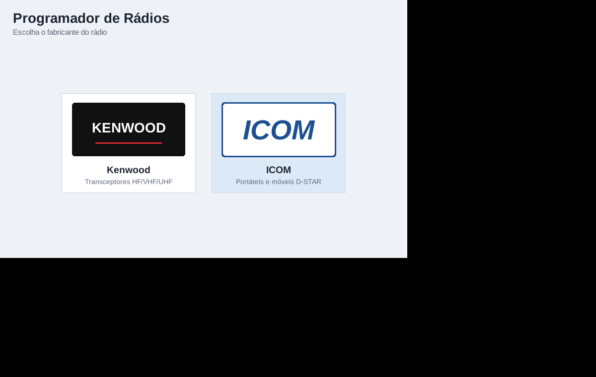
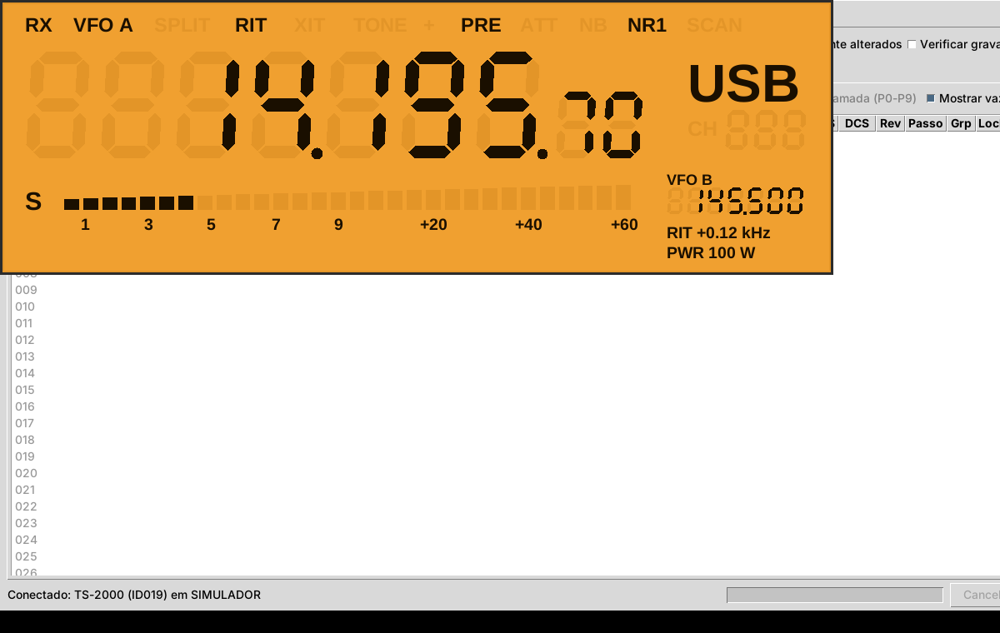
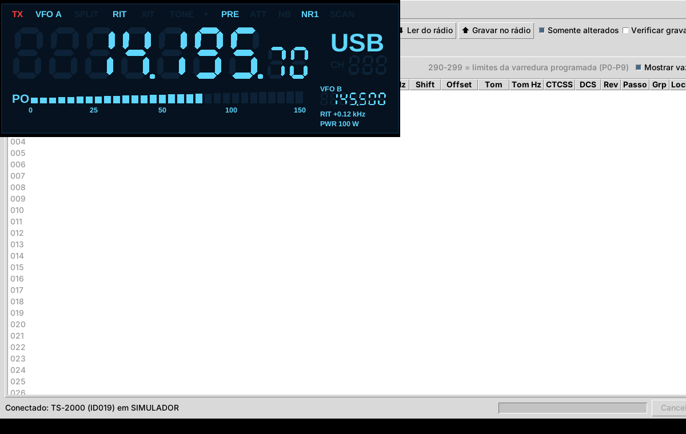
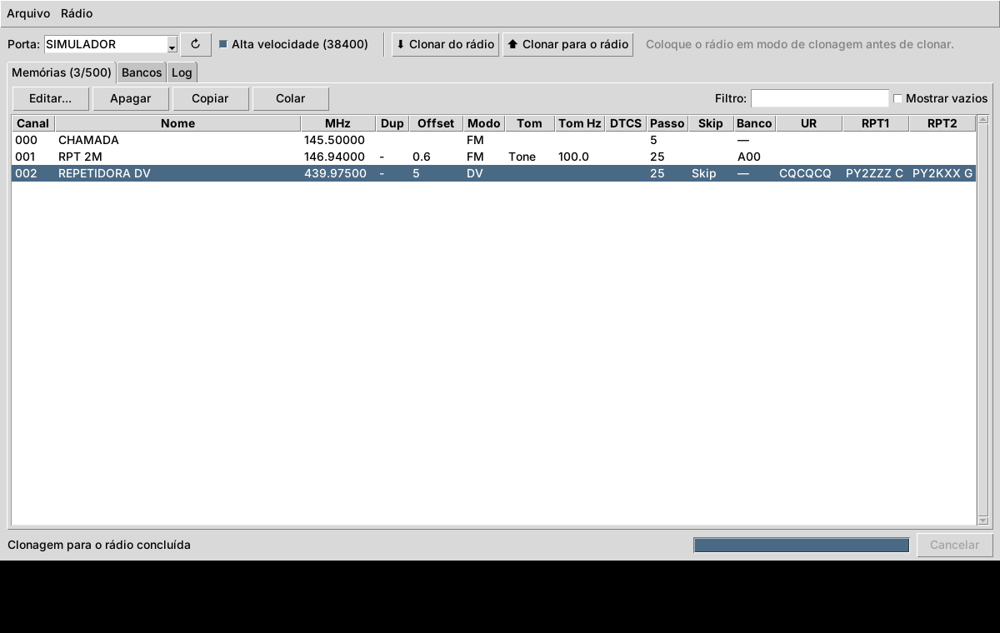

# PT2VHF Prog Tool — Kenwood TS-2000, Icom ID-51A Plus2 e ID-880H

Aplicativo desktop (Python + Tkinter) para programar rádios pela porta
serial. A tela inicial mostra os fabricantes. Clicando em **Kenwood**
aparece o TS-2000; clicando em **ICOM** aparecem o ID-51A Plus2 e o ID-880H.



## Kenwood TS-2000 (CAT, tempo real)

- **Memórias 000-299**: frequência RX, split (freq./modo TX), modo, shift,
  offset, reverse, tom/CTCSS/DCS, passo, grupo, lockout e nome (8 caracteres).
  Os canais 290-299 são os limites de varredura programada (início/fim).
- **Menus**: lê e grava os itens do menu pelo comando `EX`, com descrições e
  listas de valores. Qualquer menu também pode ser editado em valor bruto.
- **Download/Upload**: tudo, só memórias, só menus, só os itens selecionados
  ou **somente os alterados**. A gravação pode ser verificada com uma releitura.
- **Varrer menus**: consulta EX000-EX099 (e, se você quiser, os sub-menus
  00-09) e mostra todos os menus que o rádio aceita, sem gravar nada.
- **Display em tempo real** (botão Display LCD): uma janela separada simula um LCD grande do
  rádio (veja abaixo).
- **Arquivos**: projeto `.ts2k` (JSON) e importação/exportação de memórias
  em CSV para usar em planilhas.
- **Log CAT**: mostra todo o tráfego serial, útil para diagnóstico.


### Display em tempo real

Conecte ao rádio e clique em **Display LCD** (ou **Rádio › Display em tempo
real**). A janela consulta o rádio cerca de 5 vezes por segundo e mostra:

- frequência principal em dígitos de 7 segmentos (até 10 Hz) e o modo;
- RX/TX, VFO A/B ou canal de memória, SPLIT, RIT/XIT (com o offset), tipo
  de tom e shift;
- S-meter de 30 segmentos (vira medidor de potência PO durante a TX);
- frequência do VFO B, potência ajustada, PRE, ATT, NB e NR.

Clique com o botão direito no display para trocar o tema (âmbar como o do
TS-2000, verde, azul noturno ou vermelho noturno) e para deixá-lo sempre no
topo. F11 alterna a tela cheia, útil num segundo monitor. Durante uma
leitura ou gravação, o display pausa para não disputar a serial.

Comandos usados: `IF` (frequência, modo, RX/TX, VFO, canal, RIT/XIT,
split, tom), `SM0` (S-meter), `FB`, `PC`, `PA`, `RA`, `NB` e `NR`.




## Icom ID-51A Plus2 e ID-880H (clonagem)

Esses rádios são programados por **clonagem**: o programa lê a memória
inteira do rádio (a "imagem"), você edita no computador e grava a imagem
de volta.

- Edita frequência, duplex/offset, modo (FM, NFM, AM, NAM, DV), tom
  (Tone, TSQL, DTCS, TSQL-R, DTCS-R), tons, DTCS e polaridade, passo, skip/
  P.skip, banco (A-Z) e índice, nome (16 caracteres no ID-51 e 8 no ID-880)
  e os campos D-STAR (UR, RPT1, RPT2, código digital e, no ID-51, o
  silenciador digital DSQL/CSQL).
- Também edita os nomes dos bancos, tem filtro, copiar/colar e exporta CSV.
- Abre e salva arquivos **.icf**, o mesmo formato do software da Icom
  (CS-51PLUS2 / CS-80/880) e do CHIRP.
- **Todo o resto da imagem é preservado**: configurações que o programa não
  edita voltam para o rádio exatamente como vieram.
- Clonagem em alta velocidade (38400 bps) ou a 9600 bps, e funciona com
  cabos que ecoam os dados.

Por segurança, o botão **Clonar para o rádio** só fica liberado depois que
você clona do rádio ou abre um `.icf` do mesmo modelo, porque a clonagem
substitui a memória inteira. **Salve um backup `.icf` antes da primeira
gravação.**

Para clonar, ligue o cabo de clonagem/dados do rádio (por exemplo, o
OPC-2218LU no ID-51; no ID-880H, o cabo de clonagem compatível com o rádio,
conforme o manual), coloque o rádio em **modo de clonagem** pelo menu do
próprio rádio e só então clique em clonar.



## Fotos dos rádios e logotipos

Os logotipos e rádios da tela inicial são desenhos simples. Para usar
fotos de verdade, coloque arquivos PNG na pasta `assets/` com estes
nomes: `kenwood.png`, `icom.png`, `ts2000.png`, `id51plus2.png` e
`id880h.png`. O programa reduz a imagem para caber no botão.

## Instalação

Requer Python 3.9+ com Tkinter (já vem no instalador do python.org no
Windows e no macOS; no Linux instale `python3-tk`).

```bash
pip install -r requirements.txt     # pyserial
python main.py                      # tela inicial
python -m ts2000prog                # abre direto o TS-2000
```

Em qualquer editor, escolha a porta `SIMULADOR` para testar sem rádio. O
TS-2000 simulado tem frequência, S-meter e TX variando para o display.

## Instalador para Windows

O arquivo `PT2VHFProgTool-<versão>-instalador.exe` instala o programa no
Windows 10/11 de 64 bits. Ele cria atalhos no Menu Iniciar e, se você
quiser, no desktop. A desinstalação fica em **Configurações › Aplicativos**
e também no Menu Iniciar. Não é preciso instalar Python.

- O instalador não tem assinatura digital. Por isso o Windows SmartScreen
  pode mostrar "O Windows protegeu o computador": clique em **Mais
  informações › Executar assim mesmo**.
- Para o cabo USB-serial, instale o driver do fabricante (FTDI, Prolific,
  Silicon Labs ou o driver do cabo Icom). A porta COM aparece na lista
  **Porta** do programa.
- Fotos dos rádios: crie a pasta `%USERPROFILE%\.ts2000prog\assets` e
  coloque os PNGs lá (veja a seção acima). Uma tabela de menus
  personalizada vai em `%USERPROFILE%\.ts2000prog\menus_ts2000.json`.

### Pacotes para Linux e página de download

`packaging/linux/build.sh` gera o `.deb` (Debian/Ubuntu/Mint, depende de
`python3-tk` e `python3-serial`) e um `.tar.gz` para outras distribuições
e macOS. `packaging/release.sh` roda os testes, gera todos os pacotes
(Windows via Wine e Linux) e monta a página de download em `dist/site/`,
com SHA-256 e o zip do código-fonte. O arquivo `dist/site.zip` é o que vai
para a hospedagem.

### Como gerar o instalador

O empacotamento usa PyInstaller (modo pasta) e NSIS. Os arquivos ficam em
`packaging/windows/`.

| Onde | Comando |
|---|---|
| Windows (Python 3.12 do python.org + NSIS 3) | `packaging\windows\build.bat` |
| Linux, via Wine | `packaging/windows/build_wine.sh` |
| GitHub Actions | workflow **Instalador Windows** (manual, ou ao criar uma tag `v*`); o instalador sai como artefato |

Para mudar a versão, altere `__version__` em `launcher/__init__.py`. O
ícone é gerado por `packaging/windows/make_icon.py` (requer Pillow).

## Conexão com o TS-2000

1. Use um cabo serial **direto** (não null-modem) DB-9 entre o PC e a porta
   COM do TS-2000. Um adaptador USB-serial com FTDI ou Prolific funciona bem.
2. A taxa de transmissão precisa ser igual à do **menu 56** do rádio (o padrão
   de fábrica é 9600). Use 8N1 e stop bits = 1. Se o menu do rádio estiver em
   2 stop bits, ajuste aqui também.
3. O TS-2000 usa controle de fluxo **RTS/CTS**. Deixe essa opção marcada,
   a menos que seu cabo não tenha essas linhas.
4. Clique em **Conectar**. O app confirma que o rádio responde `ID019`
   (TS-2000) e desliga o Auto-Information (`AI0`) durante a sessão. O estado
   anterior do AI é restaurado ao desconectar.

## Fluxo de trabalho no TS-2000

1. **⬇ Ler do rádio** baixa as 300 memórias e os menus (leva cerca de
   20-40 s a 9600 bps).
2. Dê dois cliques num canal ou menu para editar. Itens alterados aparecem
   em amarelo.
3. **⬆ Gravar no rádio** com "Somente alterados" marcado grava só o que você
   mudou. Desmarcado, grava tudo, e os canais vazios no projeto são **apagados**
   no rádio (o app pede confirmação antes).
4. Salve o projeto com **Arquivo › Salvar** para ter um backup.

Quando você abre um projeto salvo, todos os itens ficam marcados como
alterados. Assim, "Gravar no rádio" restaura o projeto inteiro.

## Protocolo do TS-2000

| Função | Comando |
|---|---|
| Identificação | `ID;` → `ID019;` |
| Ler memória (RX / TX ou fim de varredura) | `MR0nnn;` / `MR1nnn;` |
| Gravar memória | `MW0nnn<35 dígitos><nome>;` e `MW1nnn…;` para split/290-299 |
| Apagar memória | `MW0nnn` + 35 zeros |
| Ler / gravar menu | `EXmmmss00;` / `EXmmmss00<valor>;` |

O layout dos campos de `MR`/`MW` (frequência de 11 dígitos, modo, lockout,
tipo de tom, tom 01-39, CTCSS 01-39, DCS 000-103, reverse, shift, offset de
9 dígitos, passo, grupo e nome) foi conferido com as implementações do
Hamlib (`rigs/kenwood/ts2000.c`) e do CHIRP (`drivers/ts2000.py`). Depois de
cada gravação, o app envia `ID;` para sincronizar e detectar respostas de
erro (`?;`, `E;`, `O;`). Ele tenta de novo automaticamente até 3 vezes.

## Tabela de menus do TS-2000

A tabela de menus (00 a 62, com os sub-menus A, B, C...) e os valores de
cada um seguem o manual do TS-2000 (lista de menus e tabela de parâmetros
do comando `EX`). Nos sub-menus, o comando usa `P2 = 01` para A, `02` para
B etc.; menus sem sub-menu usam `00`. Antes de gravar menus em massa pela
primeira vez, faça **Ler do rádio** e salve o projeto como backup.

Para personalizar, use **Menus › Exportar definições**, edite o JSON e
salve como `menus_ts2000.json` na pasta do programa ou em `~/.ts2000prog/`.

## Como os formatos Icom foram verificados

Os mapas de memória e o protocolo de clonagem seguem os drivers do CHIRP
(`icf.py`, `id31.py`, `id51plus.py` e `id880.py`). Para conferir, o
programa foi testado contra o próprio código do CHIRP:

- 220 memórias aleatórias por modelo, gravadas por este programa e lidas
  pelo CHIRP, e o contrário, sem nenhuma divergência;
- quadros de dados idênticos aos do CHIRP;
- arquivos `.icf` idênticos byte a byte, incluindo o hash `#CD`.

Não houve teste com rádios reais. Limitações conhecidas:

- No ID-880H, o CHIRP grava um "flag de nome" num endereço que se sobrepõe
  às memórias. Por isso, este programa não grava esse flag. Os nomes são
  gravados normalmente, mas se algum não aparecer no rádio, me avise.
- Os códigos de tom 2/3 (TSQL) e 4/5 (DTCS) aparecem separados porque o
  rádio guarda as duas variantes. Novos canais usam o mesmo código que o
  CHIRP usa.
- Listas de indicativos D-STAR (MYCALL/URCALL/repetidoras) e as demais
  configurações não são editadas, mas são preservadas.

### Licença

Este programa é software livre sob a **GNU GPL versão 3** (arquivo
`LICENSE`). Os layouts dos rádios Icom foram derivados do CHIRP, também
GPLv3. Ao distribuir os executáveis, distribua junto o código-fonte (a
página de download gerada já inclui o zip do código).

## Testes

```bash
python -m unittest discover -s tests -v
```

Os testes cobrem: comandos do TS-2000 e o ciclo de leitura/gravação contra
o rádio simulado, a varredura de menus, o display (`IF`/`SM`), os arquivos
de projeto/CSV, o codec das memórias Icom (incluindo a preservação de bits
desconhecidos), a clonagem nos dois sentidos com e sem cabo de eco, a
rejeição de modelo errado e os arquivos `.icf`.

## Estrutura

```
main.py                   tela inicial
launcher/app.py           páginas: fabricantes -> modelos
launcher/art.py           desenhos dos logotipos/rádios (ou assets/*.png)
ts2000prog/protocol.py    tabelas e formato MR/MW/EX
ts2000prog/radio.py       comunicação CAT, download/upload, varredura, status
ts2000prog/status.py      decodificação do IF/SM para o display
ts2000prog/lcd.py         display LCD em tempo real
ts2000prog/menus.py       definições dos menus (substituíveis por JSON)
ts2000prog/fileio.py      projeto .ts2k e CSV
ts2000prog/simulator.py   TS-2000 simulado
ts2000prog/gui.py         programador do TS-2000
icomprog/models.py        mapas de memória ID-51A Plus2 / ID-880H
icomprog/clone.py         protocolo de clonagem Icom
icomprog/icf.py           arquivos .icf
icomprog/simulator.py     rádio Icom simulado
icomprog/gui.py           editor de memórias Icom
common/tkthreads.py       ajuste do tkinter para uso com threads
common/ui.py              fonte padrão (Arial no Windows)
packaging/windows/        spec do PyInstaller, instalador NSIS, scripts
```
