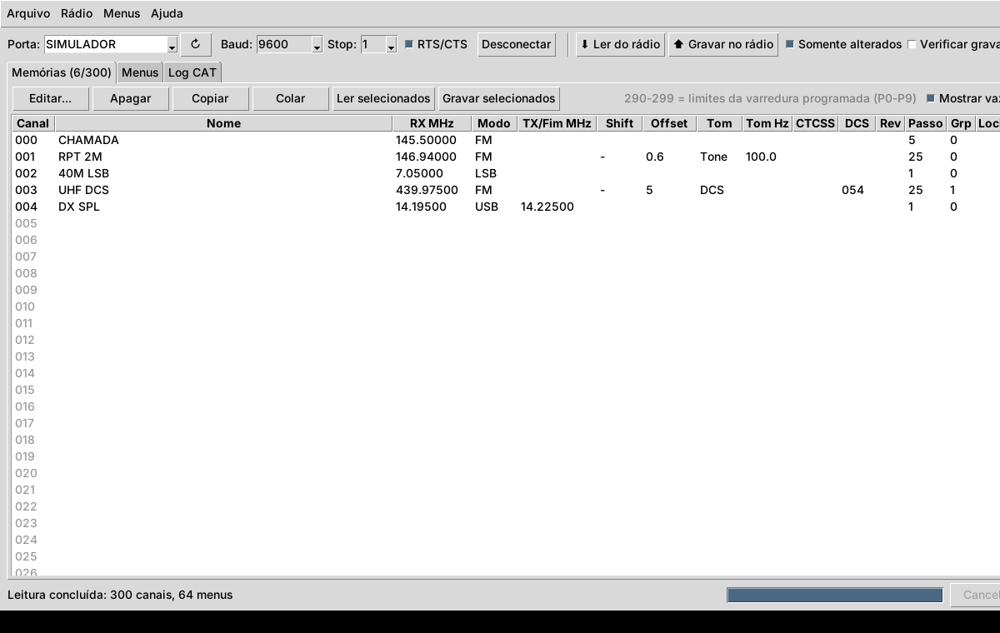

# Programador Kenwood TS-2000

Aplicativo desktop (Python + Tkinter) para editar a programação do
transceptor **Kenwood TS-2000 / TS-B2000 / TS-2000X**. Ele lê e grava o rádio
pela porta serial usando os comandos CAT do TS-2000.

- **Memórias 000-299**: frequência RX, split (freq./modo TX), modo, shift,
  offset, reverse, tom/CTCSS/DCS, passo, grupo, lockout e nome (8 caracteres).
  Os canais 290-299 são os limites de varredura programada (início/fim).
- **Menus**: lê e grava os itens do menu pelo comando `EX`, com descrições e
  listas de valores. Qualquer menu também pode ser editado em valor bruto.
- **Download/Upload**: tudo, só memórias, só menus, só os itens selecionados
  ou **somente os alterados**. A gravação pode ser verificada com uma releitura.
- **Varrer menus**: consulta EX000-EX099 (e, se você quiser, os sub-menus
  00-09) e mostra todos os menus que o rádio aceita, sem gravar nada.
- **Arquivos**: projeto `.ts2k` (JSON) e importação/exportação de memórias
  em CSV para usar em planilhas.
- **Log CAT**: mostra todo o tráfego serial, útil para diagnóstico.
- **Simulador**: escolha a porta `SIMULADOR` para testar o app sem o rádio.



## Instalação

Requer Python 3.9+ com Tkinter (já vem no instalador do python.org no
Windows e no macOS; no Linux instale `python3-tk`).

```bash
pip install -r requirements.txt     # pyserial
python main.py                      # ou: python -m ts2000prog
```

## Conexão com o rádio

1. Use um cabo serial **direto** (não null-modem) DB-9 entre o PC e a porta
   COM do TS-2000. Um adaptador USB-serial com FTDI ou Prolific funciona bem.
2. A taxa de transmissão precisa ser igual à do **menu 56** do rádio (o padrão
   de fábrica é 9600). Use 8N1 e stop bits = 1. Se o menu do rádio estiver em
   2 stop bits, ajuste aqui também.
3. O TS-2000 usa controle de fluxo **RTS/CTS**. Deixe essa opção marcada,
   a menos que seu cabo não tenha essas linhas.
4. Clique em **Conectar**. O app confirma que o rádio responde `ID019`
   (TS-2000) e desliga o Auto-Information (`AI0`) durante a sessão. O estado
   anterior do AI é restaurado ao desconectar.

## Fluxo de trabalho

1. **⬇ Ler do rádio** baixa as 300 memórias e os menus (leva cerca de
   20-40 s a 9600 bps).
2. Dê dois cliques num canal ou menu para editar. Itens alterados aparecem
   em amarelo.
3. **⬆ Gravar no rádio** com "Somente alterados" marcado grava só o que você
   mudou. Desmarcado, grava tudo, e os canais vazios no projeto são **apagados**
   no rádio (o app pede confirmação antes).
4. Salve o projeto com **Arquivo › Salvar** para ter um backup.

Quando você abre um projeto salvo, todos os itens ficam marcados como
alterados. Assim, "Gravar no rádio" restaura o projeto inteiro.

## Protocolo utilizado

| Função | Comando |
|---|---|
| Identificação | `ID;` → `ID019;` |
| Ler memória (RX / TX ou fim de varredura) | `MR0nnn;` / `MR1nnn;` |
| Gravar memória | `MW0nnn<35 dígitos><nome>;` e `MW1nnn…;` para split/290-299 |
| Apagar memória | `MW0nnn` + 35 zeros |
| Ler / gravar menu | `EXmmmss00;` / `EXmmmss00<valor>;` |

O layout dos campos de `MR`/`MW` (frequência de 11 dígitos, modo, lockout,
tipo de tom, tom 01-39, CTCSS 01-39, DCS 000-103, reverse, shift, offset de
9 dígitos, passo, grupo e nome) foi conferido com as implementações do
Hamlib (`rigs/kenwood/ts2000.c`) e do CHIRP (`drivers/ts2000.py`). Depois de
cada gravação, o app envia `ID;` para sincronizar e detectar respostas de
erro (`?;`, `E;`, `O;`). Ele tenta de novo automaticamente até 3 vezes.

## ⚠️ Sobre a tabela de menus

Os índices `EX` dos menus 12, 13, 20, 21, 22 e 31 foram confirmados em
software de terceiros (Hamlib e flrig) e aparecem com ✓. Os demais seguem a
numeração do painel do rádio e as descrições do manual. **Confira-os com o
manual de comandos do seu rádio antes de gravar menus em massa.** Em especial:

- Para os sub-menus (ex.: 06A/06B), o app supõe que o sub-menu vai no campo
  `ss` (A = 00, B = 01…). Use **Menus › Varrer menus** com sub-menus para ver
  o que o seu rádio realmente aceita.
- Vários menus aparecem como "Menu NN" com valor bruto, porque não incluí
  descrições sem uma fonte confiável.

Para corrigir ou completar a tabela, use **Menus › Exportar definições**,
edite o JSON (nomes, `ex`, `sub` e `options`) e salve como
`menus_ts2000.json` na pasta do programa ou em `~/.ts2000prog/`. Esse arquivo
é carregado automaticamente e substitui a tabela interna.

Recomendação: antes de gravar menus pela primeira vez, faça **Ler do rádio**
e salve o projeto como backup.

## Testes

```bash
python -m unittest discover -s tests -v
```

Os testes cobrem a codificação e decodificação dos comandos, o ciclo
completo de leitura/gravação/verificação contra o rádio simulado, a varredura
de menus, o cancelamento e os arquivos de projeto/CSV.

## Estrutura

```
main.py                 ponto de entrada
ts2000prog/protocol.py  tabelas (modos, tons, DCS, passos) e formato MR/MW/EX
ts2000prog/radio.py     comunicação serial, download/upload, varredura
ts2000prog/menus.py     definições dos menus (substituíveis por JSON)
ts2000prog/fileio.py    projeto .ts2k e CSV
ts2000prog/simulator.py rádio simulado para testes
ts2000prog/gui.py       interface Tkinter
```
